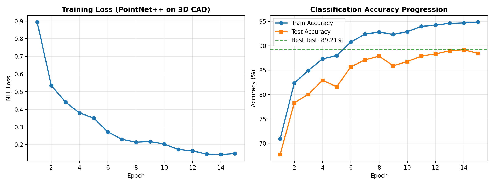
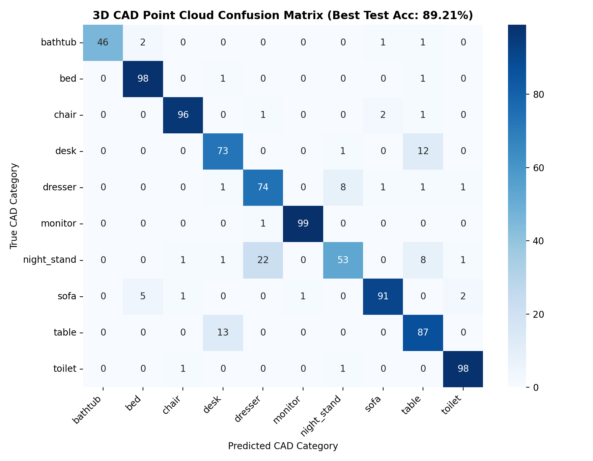

# 3D Object Classification from CAD Meshes with PointNet++

A PyTorch pipeline that converts 3D CAD surface meshes into point clouds and classifies them into the 10 object categories of **ModelNet10** using PointNet++ (single-scale grouping).

ModelNet10 contains household and furniture objects (bathtub, bed, chair, desk, dresser, monitor, night stand, sofa, table, toilet). This model has not been tested on mechanical or engineering parts.

## Results

| Measure (908 test models) | Accuracy |
|---|---|
| Final epoch (15 of 15) | 88.44% |
| Best epoch (14), selected using test accuracy | 89.21% |

**Evaluation note:** there is no separate validation set. The test set was evaluated after every epoch and used to choose the saved checkpoint, so 89.21% is an optimistic estimate.

The confusion matrix comes from a second evaluation of the saved checkpoint. Its diagonal totals 815 of 908 (89.76%), which differs from the 89.21% logged during training, probably because PointNet++ starts farthest point sampling from a random point.

The main errors are between similar shapes:

- Night stand is the weakest class (53 of 86 correct), with 22 predicted as dresser
- Table predicted as desk: 13 of 100
- Desk predicted as table: 12 of 86

## Method

1. **Sampling:** 1,024 surface points per mesh with `trimesh` (3,991 training and 908 test models)
2. **Normalization:** each point cloud is centred at the origin and scaled to a unit sphere
3. **Augmentation (training only):** random rotation about the Z axis and Gaussian jitter (σ = 0.01)
4. **Model:** `pointnet2_cls_ssg` with `normal_channel=False`
5. **Training:** 15 epochs, batch size 32, Adam (learning rate 0.001, weight decay 1e-4), learning rate halved every 5 epochs

## How to run

Open `3D_CAD_PointNet2_Classifier.ipynb` in Google Colab with a GPU and run the cells in order. The notebook clones the model code and downloads ModelNet10. The last cell downloads the outputs and works only in Colab.

No random seed is set, so results will vary between runs.

## Limitations and next steps

- Hold out part of the training set for validation, then evaluate on the test set once
- Set random seeds and report the average over several runs
- Test on a dataset of engineering parts

## Credits

- PointNet++ model and loss code: [yanx27/Pointnet_Pointnet2_pytorch](https://github.com/yanx27/Pointnet_Pointnet2_pytorch) (MIT License)
- Method: Qi et al., *PointNet++: Deep Hierarchical Feature Learning on Point Sets in a Metric Space*, NeurIPS 2017
- Data: [ModelNet10](https://modelnet.cs.princeton.edu/), Princeton University

## Files

- `3D_CAD_PointNet2_Classifier.ipynb`: data preparation, training and evaluation
- `best_pointnet2_cad.pth`: checkpoint from epoch 14
- `training_curves.png`, `confusion_matrix.png`, `cad_predictions_grid.png`: figures
- `requirements.txt`: Python dependencies
